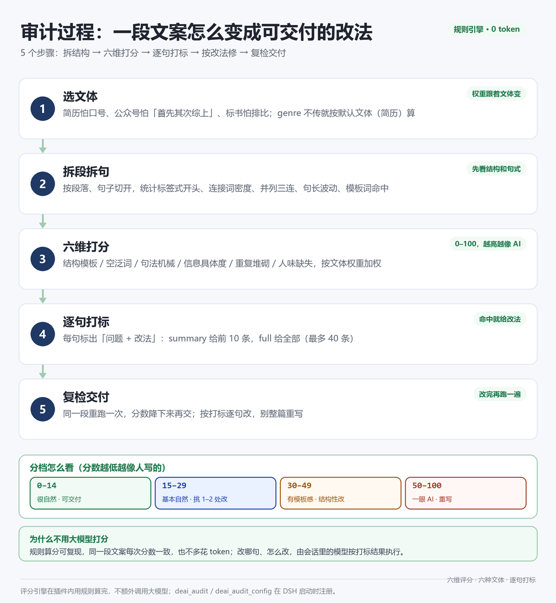

<p align="center">
  
</p>

<div align="center">

[](https://github.com/deepseek-ai/deepseek-harness)
[]()
[]()
[](./LICENSE)

</div>

---

## 1. 它是什么

在 DSH 对话里给中文文案做一次「AI 味体检」：先打 0–100 分，再说清楚是哪些句子像 AI、该往哪儿改。

它解决的是那种说不清的感觉——「这段读着有点假，但不知道假在哪」。插件把这句感觉拆成六个可以数的维度（结构、空泛、句式、具体、重复、人味），给每句命中问题的文案标出**问题类型 + 一句改法**。你改完再跑一遍，分数降下来再交。

几个明确的设计选择：

- 评分由规则算出来，不调用模型。六个维度各 0–100 分，同一段文案每次结果一致，可复现，也不多花 token。
- 六种文体分开算权重。简历里结构占 30、公众号里人味占 15，同一个模板套不了所有文体。
- 打标只指出哪句有问题、该往哪儿改，不代写全文。`summary` 给前 10 条，`full` 给最多 40 条，每条附一句改法。
- 词表和权重都放在 JSON 配置里：默认值在 `config/deai-config.json`，用户覆盖写 `~/.dsh/deai-audit-config.json`，不用改代码。

## 2. 一次真实审计

下面这段简历文案是故意写的「AI 味」版本，实际调用结果：

```text
• 赋能业务团队，打造全链路闭环，全面提升交付效率
• 负责项目管理工作，推动跨部门协同，助力业务增长
• 深度参与系统建设，实现端到端流程优化与能力沉淀
• 沉淀方法论体系，形成可复制的打法，支撑后续发展
```

```text
AI 味分数：52.3/100（一眼 AI，必须重写）　文体：简历 / 述职
维度：结构模板 15 / 空泛词 100 / 句法机械 61 / 信息具体度 75 / 重复堆砌 0 / 人味缺失 100
统计：段落 4 / 句子 4 / 平均句长 23 / 变异系数 0 / 标签式 0 / 模板词 12 / 空句比例 0.75
提示：最怕标签式结构和口号；数字、系统名、角色是硬通货

要改的句子（7/7 条）：
1. [空泛词 赋能/闭环/打造] 赋能业务团队，打造全链路闭环，全面提升交付效率
   改法：换成具体动作或事实
2. [空泛词 助力] 负责项目管理工作，推动跨部门协同，助力业务增长
   改法：换成具体动作或事实
3. [没有具体信息] 负责项目管理工作，推动跨部门协同，助力业务增长
   改法：补对象/数字/时间/动作
...
```

换成同一件事的「人话」版本：

```text
• 带 6 人团队做理赔系统重构：材料从 7 张压到 3 张，平均 2.4 天到账（改前 11 天）
• 在浦东、杨浦两个分局驻场 3 周，和窗口一起重排流程，返工两次
• 用 Vue + Spring Boot 重写材料校验，日单量 1.2 万，出错率从 3.1% 降到 0.6%
```

结果 **6.3/100（很自然）**，只标了一句「一句太长」，建议拆句。

两次审计都是真实调用，上面的 52.3 和 6.3 就是这次会话跑出来的。分数只是入口，真正有用的是打标句和改法——别为了降分把事实删了。

## 3. 审计过程



1. **选文体**：`resume` / `report` / `article` / `marketing` / `bid` / `email`，不传就按简历算。文体决定六维权重和专属套话表。
2. **拆段拆句**：按段落和句子切开，统计标签式开头、连接词密度、三连并列、句长波动、模板词命中。
3. **六维打分**：六个维度各自 0–100，越高越像 AI，按文体权重加权成总分。
4. **逐句打标**：命中问题的句子标出类型和改法。`summary` 给前 10 条，`full` 给全部（最多 40 条）。
5. **复检交付**：改完再跑一遍，分数降下来再交。按打标逐句改，别整篇重写。

## 4. 快速开始

### 4.1 前置条件

- DSH 桌面版，已实测 **0.2.1-rc.2**，需要支持 `ctx.tools` 工具注册的版本。
- 插件是单文件纯 JS，不用装 Python、不用下模型。
- 装完要重启 DSH（含托盘退出）才生效，host 插件只在启动时注册工具。

### 4.2 安装

```bash
git clone https://github.com/zz12hui/dsh-deai-audit.git
```

1. 把仓库内容复制到 `%USERPROFILE%\.dsh\profiles\desktop\node_modules\dsh-local-deai-audit\`。目录名要保持 `dsh-local-deai-audit`（和 `package.json` 的 `name` 一致），否则 profile 解析不到。
2. 在 `%USERPROFILE%\.dsh\profiles\desktop\cordis.patch.yml` 末尾追加：

   ```yaml
   - insert:
       - id: deai-audit-panel
         name: 'dsh-local-deai-audit'
   ```

3. **重启 DSH**，然后说一句「审一下这段文案」验证。助手应该直接调用 `deai_audit`，贴出分数、六维和打标句。

## 5. 两个工具

| 工具 | 做什么 | 参数 |
|---|---|---|
| `deai_audit` | 六维评分 + 逐句打标 + 改法 | `text`（必填）；`genre`（六种文体之一）；`detail`（`summary` 前 10 条 / `full` 全部） |
| `deai_audit_config` | 查看和修改配置 | `action`：`get` / `genres` / `set` / `reset`；`config`（`set` 时传完整 JSON） |

输出是结构化的：`score`、`band`、`dims`（六维分）、`flags`（打标句 + 改法）、`stats`（段落/句子/平均句长等）、`note`（文体提示）。

## 6. 评分规则

六个维度，**都是越高越像 AI**：

| 维度 | 看什么 |
|---|---|
| 结构模板 | 标签式开头比例、模板词连续出现、并列动词开头、bullet 长度过于整齐 |
| 空泛词 | 模板词和套话密度（通用词表 + 各文体专属词表） |
| 句法机械 | 句长变异系数、句子开头重复、连接词密度、三连并列 |
| 信息具体度 | 没有数字/系统名/角色/动作的「空句」占比 |
| 重复堆砌 | 6-gram 反复出现的次数 |
| 人味缺失 | 口语词、第一人称、时间地点细节的密度（越少分越高） |

权重按文体走，加起来都是 100：

| 文体 | 结构 | 空泛 | 句式 | 具体 | 重复 | 人味 |
|---|---|---|---|---|---|---|
| 简历 / 述职 | 30 | 20 | 15 | 25 | 10 | 0 |
| 方案 / 汇报 | 25 | 25 | 15 | 20 | 10 | 5 |
| 公众号 / 知乎 | 20 | 25 | 20 | 15 | 5 | 15 |
| 营销 / 种草 | 15 | 25 | 20 | 20 | 5 | 15 |
| 标书 / 商务 | 20 | 30 | 15 | 20 | 10 | 5 |
| 邮件 / 通知 | 25 | 25 | 20 | 20 | 5 | 5 |

分档与建议动作：

| 分数 | 档位 | 建议 |
|---|---|---|
| 0–14 | 很自然 | 可交付 |
| 15–29 | 基本自然 | 挑 1–2 处改 |
| 30–49 | 有模板感，建议再改 | 结构性改，别只换词 |
| 50–100 | 一眼 AI，必须重写 | 重写，别修补 |

## 7. 配置

配置文件读取顺序：

1. 环境变量 `DEAI_CONFIG` 指向的文件
2. `~/.dsh/deai-audit-config.json`（用户覆盖）
3. 插件包内 `config/deai-config.json`（默认值）

用 `deai_audit_config` 的 `set` / `reset` 改，或者直接改用户配置文件。能改的东西：四档分界、通用词表（模板词 / 连接词 / 口语词 / 具体信息正则 / 并列动词）、各文体的权重和专属套话。

| 想做什么 | 怎么说 |
|---|---|
| 看当前配置 | 「用 deai_audit_config 看一下当前配置」 |
| 看有哪些文体 | 「列出 deai-audit 支持的文体」 |
| 恢复默认 | 「把 deai-audit 配置恢复默认」 |

## 8. 已验证 / 已知边界

已验证：

- `node --check index.js` 通过。
- 桩测试里工具注入、两个工具注册与执行、配置读取都通过了。
- profile 解析用 `createRequire(profile/package.json).resolve('dsh-local-deai-audit')` 命中。
- 真实会话里调用过 `deai_audit` 和 `deai_audit_config`，分数、打标、配置读写都正常；上面的 52.3 / 6.3 就是其中的记录。

已知边界：

- 说白了，规则数的是痕迹，不是判断力：它数得出 6-gram 重复和句长变异（「赋能」「闭环」出现几次、句子长度有多整齐），数不出观点好不好。分数高不等于文章差，分数低也不等于能交。
- 词表可以被绕过。换个说法可能就漏标，所以配置开放给人改。
- 断句和词表主要针对中文，英文文案的命中率会降。
- 一句话的文案查不出结构问题，主要看空泛词。

## 9. 目录结构

```text
dsh-deai-audit/
├── index.js                  # apply(ctx) 注册两个工具，内含评分引擎
├── cordis.patch.yml          # DSH 启动时的插件注册行
├── config/deai-config.json   # 默认配置：词表/正则/阈值/分档/六种文体权重
├── locale/                   # 插件清单里的中文名和描述
├── icon.svg
├── assets/readme/            # README 首图与过程图
└── package.json
```

## 10. 卸载与回滚

删掉 `cordis.patch.yml` 末尾的 `deai-audit-panel` 插入块和 `node_modules/dsh-local-deai-audit` 目录，重启 DSH；想彻底清干净再删 `~/.dsh/deai-audit-config.json`。

## 11. License

[MIT](./LICENSE) © 2026 zz12hui
